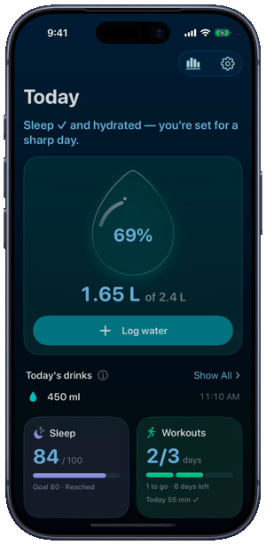
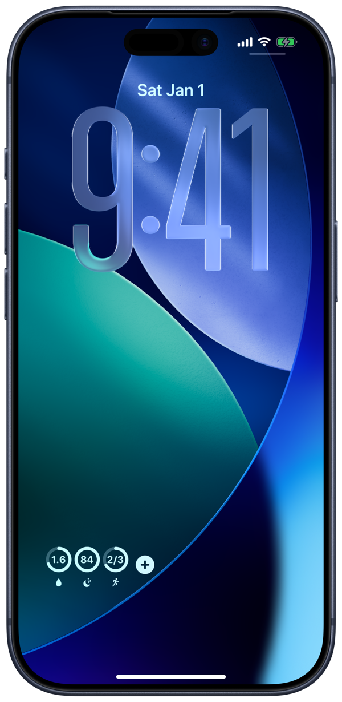
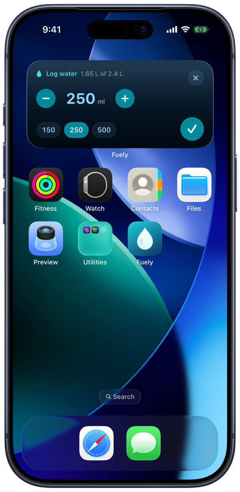
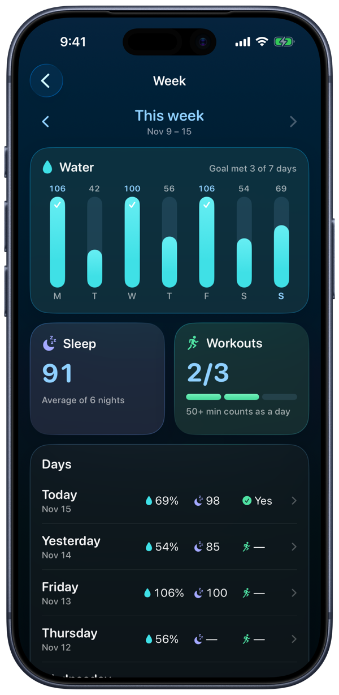

# Fuely

A personal iOS health app that shows three daily goals on one screen and on the lock screen: **water intake**, a **sleep score** and a **weekly workout goal**. Sleep and workouts come from Apple Watch through HealthKit, water is logged to Apple Health, and widgets let you log a drink without opening the app.

iPhone · iOS 18.0+ (Liquid Glass on iOS 26+) · in daily personal use

<table>
  <tr>
    <td align="center"></td>
    <td align="center"></td>
    <td align="center"></td>
    <td align="center"></td>
  </tr>
  <tr>
    <td align="center">Today</td>
    <td align="center">Lock screen widget</td>
    <td align="center">Log from the widget</td>
    <td align="center">Week history</td>
  </tr>
</table>

Screenshots use built-in sample data.

## Project

- **Water:** a goal based on body weight, pace tracking across a drinking window, an animated water drop, and quick logging with undo.
- **Sleep score:** Apple's score can't be read by other apps, so Fuely computes its own from HealthKit sleep data, fitted to match Apple's numbers.
- **Workouts:** a weekly goal set as minimum minutes per day × days per week.
- **Widgets:** 4 lock screen and 2 home screen widgets, with an in-widget amount picker (`✕ − 250 ml + ✓`) for logging water.
- **Reminders and history:** water and workout nudges only when you fall behind, plus a week view with up to 12 weeks of history.

## My role and contributions

Sole developer, product owner and designer. I built Fuely with **Claude Code** as an AI coding agent: I made the product and design decisions and reviewed the work, and the agent wrote much of the code.

- Defined the product in [`docs/DECISIONS.md`](docs/DECISIONS.md): 80 numbered decisions with a changelog.
- Designed the brand (ocean/aqua palette, rounded type, glass surfaces, app icon) and the widget set.
- Designed the architecture: a shared `FuelyCore` package holds all logic for the app and the widget.
- Built offline-first storage: water is saved on the phone first and synced to Apple Health later, because HealthKit is locked while the phone is.
- Rebuilt a sleep score that matches Apple's, and covered the core logic with 340+ unit tests.
- Fixed an iOS 26 bug where widget buttons did nothing, and tested on a real iPhone in light and dark mode, at large text sizes and on the iOS 18 fallback.

## Technologies and tools

| Area | Used |
|---|---|
| Language and UI | Swift, SwiftUI, Liquid Glass with material fallbacks |
| Apple frameworks | HealthKit, WidgetKit, App Intents, UserNotifications, BackgroundTasks |
| Data | App Group storage (JSON), HealthKit |
| Testing | Swift Testing (340+ tests) |
| Tools | Xcode, Xcode MCP, Git, Claude Code |

## Run it

1. Open `Fuely.xcodeproj` in Xcode 27.1+.
2. Put your team in `Config/Signing.local.xcconfig` (`DEVELOPMENT_TEAM = YOURTEAMID`), and change the bundle IDs and App Group to your own.
3. Build to an iPhone running iOS 18+. Run the tests on an iOS simulator with ⌘U.
